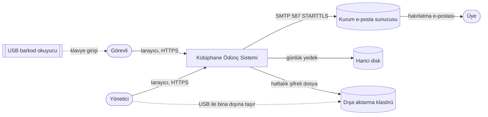
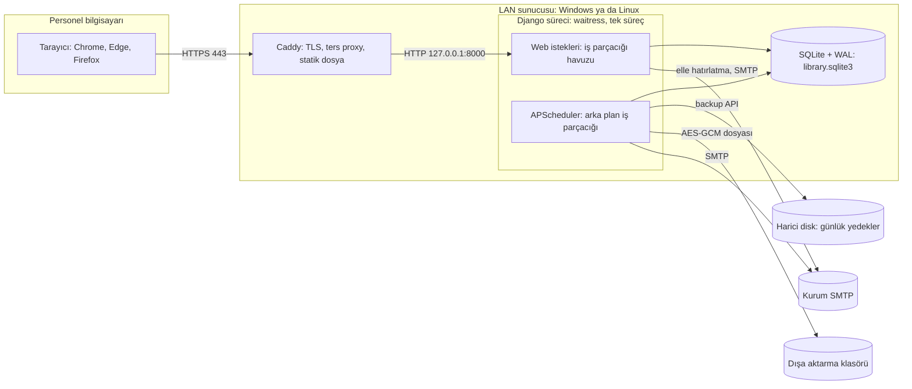
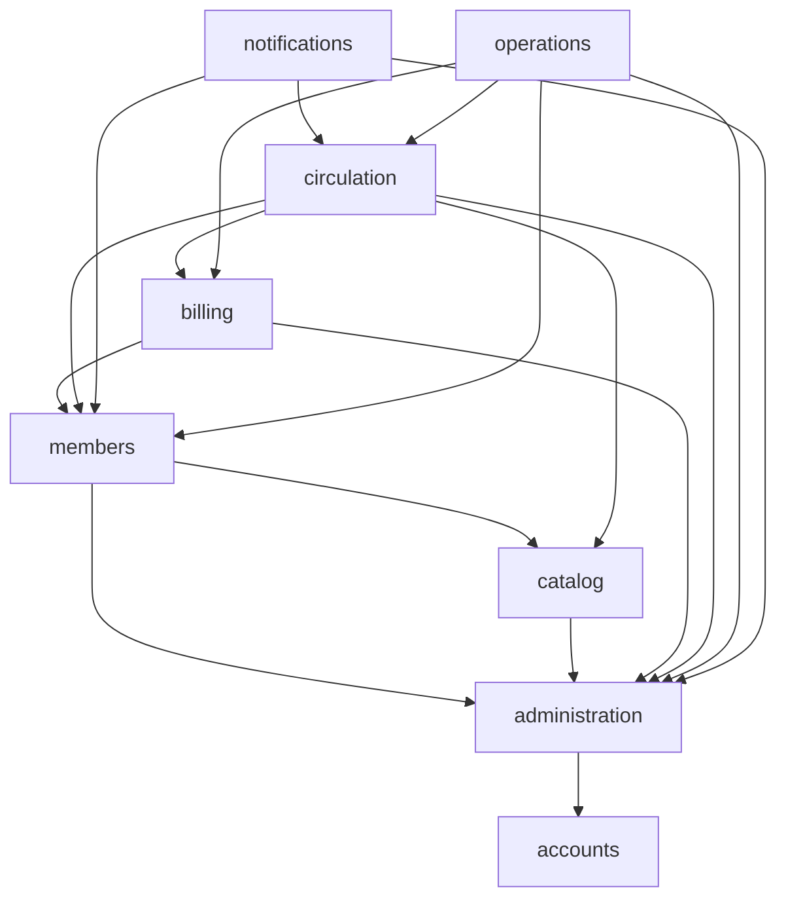
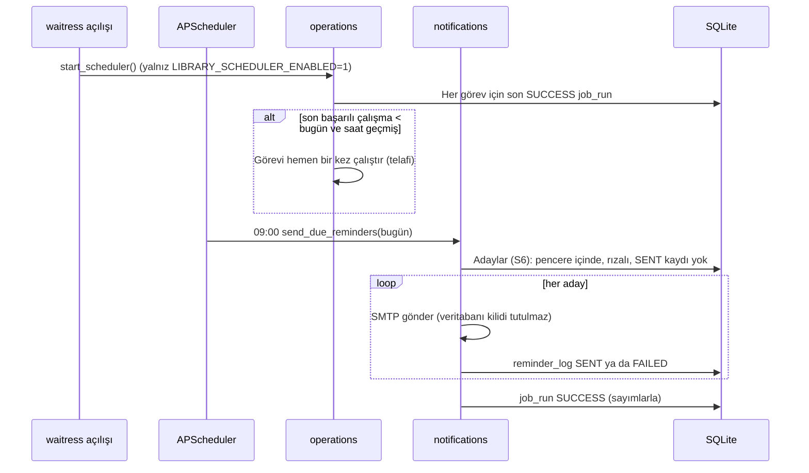
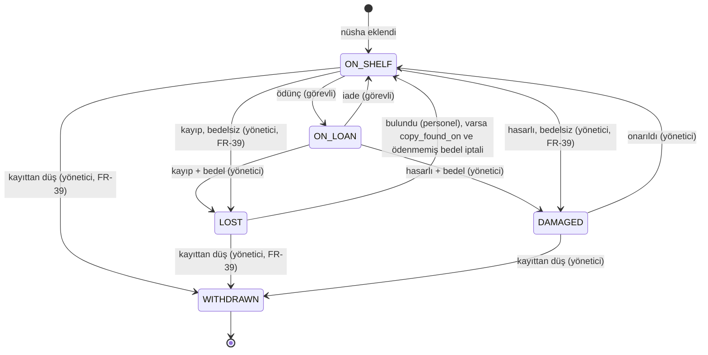
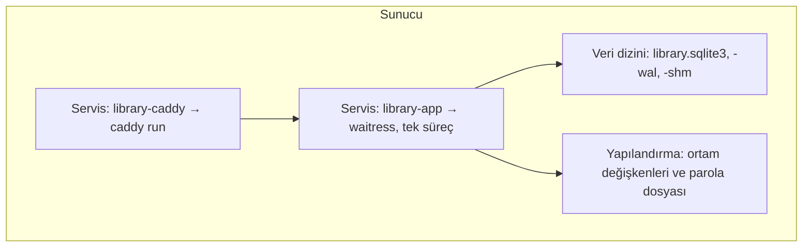

# Mimari: Kütüphane Ödünç Sistemi

- **Güncelleme:** 2026-10-31
- **İlgili dokümanlar:** [SRS](srs.md), [Veri tasarımı](data-design.md), [ADR'ler](decisions/)

## 1. Bağlam (C4 seviye 1)



Sistemi yalnız personel kullanır; üye sisteme girmez (FR-33 Won't). Dış dünyaya açılan tek bağlantı, kurumun SMTP sunucusudur ([ADR-0004](decisions/0004-email-institutional-smtp.md)). Sistem LAN dışından erişilemez (NFR-08).

## 2. Konteynerler (C4 seviye 2)



| Konteyner | Teknoloji | Sorumluluk | İletişim |
|---|---|---|---|
| Tarayıcı | Chrome, Edge, Firefox güncel sürümleri (NFR-09) | Sunucuda üretilen sayfaları gösterir; okutma akışı için odak yönetimi yapan vanilla JS çalıştırır ([ADR-0003](decisions/0003-server-rendered-html.md)) | Caddy'ye HTTPS; yerel CA kök sertifikası kurulu ([ADR-0005](decisions/0005-https-caddy-local-ca.md)) |
| Caddy | Caddy 2, `tls internal` | TLS sonlandırma, HTTP'den HTTPS'e yönlendirme, waitress'e ters proxy, statik dosya sunumu | Dışarıya 443/80; içeriye 127.0.0.1:8000 |
| Django süreci | Python 3.11, Django 5.2 LTS, waitress, APScheduler 3.x ([ADR-0001](decisions/0001-python-django.md), [ADR-0012](decisions/0012-app-server-waitress.md), [ADR-0007](decisions/0007-scheduler-apscheduler.md)) | Bütün iş mantığı, sayfalar, PDF üretimi, zamanlanmış görevler | Yalnız 127.0.0.1'i dinler; SQLite'a dosya üzerinden erişir; SMTP istemcisidir |
| SQLite | SQLite 3 (Python ile birlikte gelir), WAL ([ADR-0002](decisions/0002-sqlite-wal.md)) | Kalıcı veri | Süreç içi kütüphane; yerel diskte tutulur, ağ paylaşımında değil |
| Harici disk | Dosya sistemi | 30 günlük yedek (FR-28) | Görev tarafından yazılır |
| Dışa aktarma klasörü | Dosya sistemi | Haftalık şifreli dosya (FR-37) | Görev yazar, yönetici USB'ye kopyalar ([ADR-0006](decisions/0006-offsite-backup-usb-rotation.md)) |

## 3. Bileşenler (C4 seviye 3): Django süreci

App sınırları [ADR-0015](decisions/0015-module-boundaries.md)'e göre çizilir. Her app'te üç katman vardır:

- `domain.py`: saf fonksiyonlar. ORM, HTTP ya da saat çağrısı yoktur; "bugün" parametre olarak gelir.
- `services.py`: veritabanı işlemi, yetki ve denetim kaydı.
- `views.py`: yalnız servisleri çağırır.

Yetki denetimi servis girişinde yapılır, view dekoratörü ikinci bir güvencedir. Yetkisiz rol için `PermissionDenied` fırlatılır ve 403 döner (FR-22, NFR-07).



Oklar "kullanır" anlamına gelir; döngü yoktur. `billing.LedgerEntry → circulation.Loan` yabancı anahtarı tembel bir string referansıdır (`"circulation.Loan"`) ve import oluşturmaz. Bütün app'ler yetki için `accounts`'u kullanır; diyagramda yalnız bir ok çizildi. `accounts.services` denetim kaydı için yalnız `administration.audit` modülünü import eder; `administration` ise `accounts`'tan yalnız `permissions` modülünü kullanır ve kullanıcı modeline `AUTH_USER_MODEL` string referansıyla bağlanır. Bu yüzden modül düzeyinde import döngüsü oluşmaz. Etiket ve kart PDF'leri app olmayan `pdf/` paketini kullanır (faz 4 küçük karar 5). `members → catalog` oku yalnız `catalog.domain.normalize_tr` içindir (KL-2).

**View'lar yapraktır (KL-22):** Oklar `domain`, `services` ve `models` modülleri içindir. `views` modülleri herhangi bir app'in servisini import edebilir, ama hiçbir modül bir `views` modülünü import etmez. Bu yüzden üye ayrıntısı gibi birden çok app'e dokunan ekranlar döngü oluşturmaz.

| Bileşen | Sorumluluk | Sunduğu arayüz (servis / domain) | Kullandığı arayüzler |
|---|---|---|---|
| accounts | Personel hesapları, roller, giriş ve çıkış, oturum süresi, hesap kilidi ([ADR-0009](decisions/0009-lockout-django-axes.md)) | `require_role(Role)`; `create_staff`, `set_role`, `deactivate_staff`, `reset_password` (yönetici); kendi parolasını değiştirme ekranı ve `ForcePasswordChangeMiddleware` ([ADR-0043](decisions/0043-staff-password-change.md)) | django-axes, administration.audit |
| administration | Ayarlar, kapalı günler, denetim kaydı, görev kaydı (`job_run`, KL-1), yönetici ana sayfası (dışa aktarma ve yedek uyarısı) | `get_settings()`, `update_settings(actor, …)`; `closed_day_predicate() -> Callable[[date], bool]`; `closed_dates() -> frozenset[date]` ([ADR-0040](decisions/0040-late-days-skip-closed-dates.md)); `record_audit(actor, action, target, details)`; domain: `backup_warning(...)` ([ADR-0044](decisions/0044-backup-warning-home.md)); `jobs.run_job(job, run_on, fn)`, `last_success(job)`, `last_finished(job)`, `last_success_at(job)` (KL-1, KL-33) | accounts |
| members | Üye kaydı, arama, pasifleştirme, yeniden aktifleştirme, rıza, üye kartı PDF'i | `create_member`, `update_member`, `set_inactive` (pasifleştirme kuralı `circulation.services.deactivate_member`'da, KL-22), `reactivate_member(actor, m)` ([ADR-0042](decisions/0042-member-reactivation.md)), `set_consent(actor, m, given, on)` ([ADR-0047](decisions/0047-consent-event-ordering.md)), `search_members(q)`, `member_card_pdf(member_nos)` ([ADR-0036](decisions/0036-label-card-selection-range-checkbox.md)) | administration, catalog.domain (KL-2), PDF yardımcısı |
| catalog | Kitap ve nüsha kaydı, ISBN doğrulama, arama, etiket PDF'i | domain: `parse_isbn(raw) -> IsbnOk \| IsbnSuggest \| IsbnInvalid` ([ADR-0008](decisions/0008-isbn-correction-suggestion.md)), `normalize_tr(s)` ([ADR-0019](decisions/0019-search-normalization.md)); servis: `create_book`, `add_copies(book, n)`, `find_copy(barcode)`, `search_books(q)`, `label_pdf(copy_ids)` | administration |
| billing | Borç defteri, ödeme, af, iptal, para iadesi, döküm | domain: `allocate_fifo(open_charges, amount)`, `balance(entries)`; servis: `post_charge`, `record_payment`, `waive`, `cancel_unpaid`, `cancel_fee_manual` ([ADR-0041](decisions/0041-manual-cancellation-unlinked-fee.md)), `refund` ([ADR-0037](decisions/0037-refund-precondition-found-lost-copy.md)), `member_balance`, `statement` ([ADR-0017](decisions/0017-payment-fifo-allocation.md), [ADR-0020](decisions/0020-refund-ledger-entry.md), [ADR-0021](decisions/0021-waiver-targeted.md)) | members, administration |
| circulation | Ödünç, iade, uzatma, kayıp, hasar, bulundu, onarıldı, kayıttan düşme, geciken listesi | domain: `due_date(start, period_days, is_closed)` ([ADR-0028](decisions/0028-open-weekday-rule-shift-bound.md)), `late_days(due_on, on, closed_dates)` ([ADR-0040](decisions/0040-late-days-skip-closed-dates.md)), `fine(late_days, daily_kurus, cap_kurus)` ([ADR-0023](decisions/0023-fine-rate-snapshot.md)), `classify_member_input(raw)` ([ADR-0046](decisions/0046-checkout-member-input-classification.md)), `checkout_blockers(state)`, `renew_blockers(state)`, `check_transition(from, to)`; servis: `check_out`, `check_in`, `renew`, `deactivate_member`, `mark_lost`, `mark_damaged`, `mark_shelf_copy` ([ADR-0026](decisions/0026-shelf-copy-status-marking.md)), `mark_found`, `repair`, `withdraw`, `overdue_loans(today)`. Tam imzalar plan §4'te (G10–G12) | catalog, members, billing, administration |
| notifications | Otomatik ve elle hatırlatma, şablonlar, geciken listesi ekranı | domain: `due_reminder_kind(due_on, today) -> DUE_SOON \| OVERDUE_1 \| None`; servis: `send_due_reminders(today)`, `send_manual_reminders(actor, loan_ids)` | circulation, members, administration, Django e-posta |
| operations | Yedek, şifreli dışa aktarma ve geri yükleme, anonimleştirme, zamanlayıcı, tohum veri | `backup_db(today)`, `export_backup(passphrase)`, `restore_backup(path, passphrase)`, `anonymize_expired(today)` (borçlu üye ertelenir, [ADR-0045](decisions/0045-anonymization-deferred-for-debt.md)), `start_scheduler()`, `catch_up(today)` ([ADR-0018](decisions/0018-retention-archived-loan-counter.md)) | circulation, members, administration, cryptography |

**Domain fonksiyonlarının karmaşıklığı:**

| Fonksiyon | Zaman | Alan | Not |
|---|---|---|---|
| `due_date` | O(k), en kötü O(366) | O(1) | k = aday tarihten sonraki ardışık kapalı gün sayısı. Kapalı tarihler küme olarak verildiği için her kontrol O(1). Ayarlar en az bir haftalık açık günü zorunlu kılar (FR-24), bu yüzden tipik olarak k ≤ 7 + (ardışık tek tarihli kapalı gün sayısı). Her durumda en fazla 366 gün ileri bakılır; açık gün yoksa `NoOpenDayError` ([ADR-0028](decisions/0028-open-weekday-rule-shift-bound.md)). |
| `fine` | O(1) | O(1) | |
| `late_days` | O(c) | O(1) | c = kapalı tarih sayısı (yılda onlarca); aralıktaki tek tek kapalı tarihler sayılıp takvim günü farkından düşülür ([ADR-0040](decisions/0040-late-days-skip-closed-dates.md)) |
| `checkout_blockers` | O(1) | O(1) | Sayımlar ve bakiye girdi olarak gelir |
| `allocate_fifo` | O(k) | O(k) | k = açık kalem sayısı; girdi zaten sıralı gelir (S4) |
| `parse_isbn` | O(1) | O(1) | En fazla 13 hane |
| `normalize_tr` | O(L) | O(L) | L = metin uzunluğu |

## 4. Önemli akışlar

### 4.1 Barkodla ödünç verme (FR-07, FR-08, FR-11, NFR-11)

```mermaid
sequenceDiagram
  actor G as Görevli
  participant T as Tarayıcı
  participant V as circulation.views
  participant S as circulation.services
  participant D as circulation.domain
  participant B as billing.services
  participant DB as SQLite
  G->>T: Üye kartını okutur (kod + Enter)
  T->>V: GET /odunc/?uye=1042
  V->>S: member_status(1042)
  S->>DB: üye, açık ödünç sayısı, gecikme (S2)
  S->>B: member_balance (S3)
  S->>D: checkout_blockers(state)
  V-->>T: Üye bilgisi ve engeller; odak nüsha alanında
  G->>T: Nüshayı okutur (kod + Enter)
  T->>V: GET önizleme: nüsha ve hesaplanan son tarih
  G->>T: Enter (onay)
  T->>V: POST /odunc/ (uye, barkod, CSRF)
  V->>S: check_out(actor, 1042, "00000042")
  S->>DB: BEGIN IMMEDIATE
  S->>DB: engelleri yeniden değerlendir (S1–S3)
  S->>D: due_date(bugün, süre, kapalı_mı)
  S->>DB: INSERT loan (oran kopyasıyla), UPDATE copy ON_LOAN
  S->>DB: COMMIT
  V-->>T: 303 → ödünç ekranı; "Son tarih 16.11.2026"; odak üye alanında
```

Engeller önizlemede gösterilir. Önizleme ile POST arasında durum değişmiş olabileceği için işlem içinde yeniden değerlendirilir. Reddetme nedeni SRS'teki metinle gösterilir (AC-08). Bir engel varsa POST 200 döner ve form aynı ekranda hatayla yeniden gösterilir.

### 4.2 İade ve ceza (FR-09, FR-12)

```mermaid
sequenceDiagram
  actor G as Görevli
  participant S as circulation.services
  participant D as circulation.domain
  participant B as billing.services
  participant DB as SQLite
  G->>S: check_in(actor, "00000042")
  S->>DB: BEGIN IMMEDIATE; açık ödüncü bul (kısmi benzersiz indeks)
  S->>D: late_days(due_on, bugün); fine(gün, loan.oran, loan.üst_sınır)
  alt ceza > 0
    S->>B: post_charge(member, loan, FINE, tutar)
  end
  S->>DB: UPDATE loan (closed_on, RETURNED); UPDATE copy ON_SHELF
  S->>DB: COMMIT
  S-->>G: "İade alındı; 15,00 TL ceza yazıldı"
```

### 4.3 Günlük görevler ve telafi (FR-18, FR-25, FR-28, NFR-05)



Hatırlatma pencereleri (küçük karar 6): DUE_SOON için `bugün ∈ [son tarih − 2, son tarih]`, OVERDUE_1 için `bugün ∈ [son tarih + 1, son tarih + 7]`. Böylece sunucu kapalı kaldığı günlerden sonra hâlâ geçerli olan hatırlatmalar gönderilir, süresi geçenler gönderilmez.

## 5. Durum modeli

### 5.1 Nüsha (FR-05, FR-09, FR-15, FR-16, FR-39)



Bu diyagram dışındaki her geçiş servis katmanında `InvalidTransition` hatasıyla reddedilir. Raftaki nüshanın geçişleri `mark_shelf_copy` servisiyle yapılır ve üye ya da borç kaydı oluşturmaz ([ADR-0026](decisions/0026-shelf-copy-status-marking.md)).

### 5.2 Ödünç

Ödünç iki durumludur: açık (`closed_on IS NULL`) ve kapalı. Kapanış nedeni RETURNED, LOST ya da DAMAGED olur. Açık ödünç `renewed_on` dolana kadar bir kez uzatılabilir. Gecikme ayrı bir durum değildir; `due_on < bugün` koşulundan türetilir.

## 6. Arayüz sözleşmeleri

### 6.1 HTTP

- Bütün sayfalar oturum ister. Oturumu olmayan istek `/giris/?next=…` adresine yönlendirilir.
- Hareketsizlikte oturum 30 dakikada sona erer: `SESSION_COOKIE_AGE = 1800`, `SESSION_SAVE_EVERY_REQUEST = True` (FR-27).
- Durum değiştiren her istek POST'tur ve CSRF jetonu taşır.
- Yönetici işlemleri görevli oturumuyla 403 döndürür. NFR-07 testi, yönetici URL'lerinin listesini URL çözücüden alır ve her biri için 403 bekler.
- Üretimde `/admin/` 404 döndürür ([ADR-0024](decisions/0024-no-django-admin-in-production.md)).
- URL'ler Türkçe kısa yollar kullanır; tam liste plan §4.1'de.

### 6.2 Management command'lar (küçük karar 11)

| Komut | Girdi | Çıktı | Çıkış kodu |
|---|---|---|---|
| `send_reminders [--date YYYY-MM-DD]` | Varsayılan tarih bugün | Gönderilen, başarısız ve atlanan sayıları | 0 başarı; 1 en az bir FAILED varsa |
| `anonymize_expired [--date …]` | | Anonimleştirilen üye, bağı koparılan ödünç ve borç nedeniyle ertelenen üye sayıları ([ADR-0045](decisions/0045-anonymization-deferred-for-debt.md)) | 0 / 1 |
| `backup_db [--date …]` | `LIBRARY_BACKUP_DIR` | `library-YYYYMMDD.sqlite3`; 30 günden eski dosyalar silinir | 0 / 1 |
| `export_backup [--passphrase-file PATH]` | Son günlük yedek; varsayılan parola dosyası `LIBRARY_EXPORT_PASSPHRASE_FILE` | `LIBRARY_EXPORT_DIR/library-export-YYYYMMDD.libx` | 0 / 1 |
| `restore_backup PATH [--passphrase-file PATH] --yes` | `.sqlite3` ya da `.libx` dosyası | Veritabanını değiştirir. Uygulama durdurulmuş olmalıdır; kilit varsa reddeder | 0 / 1; 2 kullanım hatası |
| `load_seed_data --profile demo\|load --actor <kullanıcı adı> [--seed 42]` | Boş veritabanı ve aktif bir personel hesabı ([ADR-0038](decisions/0038-seed-data-actor-argument.md)) | Tohum veri (FR-29; profiller faz 4 küçük karar 12) | 0 / 1; 2 kullanım hatası |

Komutlar idempotenttir. Aynı gün ikinci kez çalıştırılan `send_reminders` yeni e-posta göndermez (AC-18).

### 6.3 Şifreli dışa aktarma dosya biçimi (`.libx`, ADR-0011)

| Alan | Boyut | Değer |
|---|---|---|
| magic | 4 bayt | `LIBX` |
| version | 1 bayt | `0x01` |
| kdf parametreleri | 3 × 4 bayt | scrypt n, r, p (büyük endian; varsayılan 2^17, 8, 1) |
| salt | 16 bayt | Rastgele |
| nonce | 12 bayt | Rastgele |
| ciphertext + tag | geri kalanı | AES-256-GCM. Başlık (magic…nonce) ilişkili veri (AAD) olarak doğrulanır |

Biçim değişikliği sürüm baytını artırır. `restore_backup` bilmediği sürümü reddeder.

### 6.4 Yapılandırma (ortam değişkenleri, küçük karar 16)

`DJANGO_SETTINGS_MODULE`, `LIBRARY_SECRET_KEY`, `LIBRARY_DB_PATH`, `LIBRARY_ALLOWED_HOSTS`, `LIBRARY_BACKUP_DIR`, `LIBRARY_EXPORT_DIR`, `LIBRARY_EXPORT_PASSPHRASE_FILE`, `LIBRARY_EMAIL_HOST`, `LIBRARY_EMAIL_PORT`, `LIBRARY_EMAIL_USER`, `LIBRARY_EMAIL_PASSWORD`, `LIBRARY_EMAIL_FROM`, `LIBRARY_SCHEDULER_ENABLED`, `LIBRARY_STATIC_ROOT` ([ADR-0029](decisions/0029-static-files-caddy.md)).

Gizli değerler depoya girmez. Windows'ta WinSW XML'indeki `<env>` ile, Linux'ta yalnız servis hesabının okuyabildiği bir systemd `EnvironmentFile` ile verilir. Eksik zorunlu değişken açılışta açık bir hatayla süreci durdurur.

## 7. Nitelik senaryoları

| NFR | Senaryo | Mimarideki karşılığı |
|---|---|---|
| NFR-01, NFR-02 | 5 personel tasarım ölçeğinde aynı anda okutma yapıyor; p95 < 500 ms | İndeksli tekil sorgular (S1–S3); IMMEDIATE işlem kısa sürer; tam sayfa isteği küçük. Faz 6'da yük setiyle ölçülür |
| NFR-03, NFR-04 | Disk arızası; son yedekten 1 saatte dönüş | Günlük tutarlı yedek (backup API); geri yükleme dosya değişimi ve `restore_backup`; yöntem AC-28'de denenir |
| NFR-05 | Sunucu bir hafta sonu kapalı kaldı | Açılışta telafi; pencereli ve tekrar engelli hatırlatma; job_run kaydı |
| NFR-06 | Parola sızıntısı denemesi | Django `Argon2PasswordHasher` ilk sırada; HTTPS ile taşıma |
| NFR-07 | Görevli, yönetici URL'sine doğrudan POST atar | Servis girişinde `require_role`; URL listesi üzerinden otomatik 403 testi |
| NFR-08 | LAN dışından erişim denemesi | waitress yalnız 127.0.0.1; Caddy LAN arayüzüne bağlanır; yönlendirici dışarı port açmaz (kurulum belgesi) |
| NFR-10 | "İSTANBUL" araması "istanbul" kaydını bulur | `normalize_tr` ve `search_key` |
| NFR-11 | Fare kullanmadan ödünç | Odak yönetimi: Enter ile alan geçişi, Enter ile onay |
| NFR-12 | 3 × 5,00 TL ceza ve 15,00 TL ödeme | Tam sayı kuruş; SQL toplamları tam sayı |
| NFR-13 | Kural modüllerinde dal kapsamı ≥ %90 | Kurallar `domain.py` içinde saf; `coverage --branch` bu modüllerle sınırlanarak ölçülür |

## 8. Dağıtım ve çalışma ortamı



- **Servisler:** Windows'ta WinSW, Linux'ta systemd ile iki servis tanımlanır; ikisi de çökünce yeniden başlar ([ADR-0010](decisions/0010-windows-service-winsw.md)). Uygulama servisi tek süreçtir. Zamanlayıcı yalnız bu serviste `LIBRARY_SCHEDULER_ENABLED=1` ile açılır.
- **Kurulum adımları** (faz 5'te kurulum belgesine dönüşür):
  1. Python 3.11 ve sanal ortam kurulur; bağımlılıklar sabit sürümlerle yüklenir.
  2. `migrate` ve `collectstatic` çalıştırılır.
  3. İlk yönetici hesabı oluşturulur.
  4. Caddy kurulur, kök sertifikası personel bilgisayarlarına yüklenir.
  5. Servisler kaydedilir.
  6. Yedek diski ve dışa aktarma klasörü bağlanır.
  7. Sistem saati NTP ile eşitlenir.
- **Statik dosyalar:** `collectstatic` dosyaları `LIBRARY_STATIC_ROOT` klasörüne yazar, Caddy `/static/` yolunu `file_server` ile sunar ([ADR-0029](decisions/0029-static-files-caddy.md)).
- **Gizli değerler:** Bölüm 6.4'teki gibi verilir. Caddy'nin CA özel anahtarı ve dışa aktarma parola dosyası yalnız servis hesabının okuyabileceği izinlerle tutulur.
- **Ortamlar:** Geliştirme ortamında `runserver`, konsol e-posta backend'i ve admin paneli açık; zamanlayıcı kapalı. Test ortamında bellek e-posta backend'i, geçici SQLite ve sabitlenmiş "bugün" kullanılır. Üretim ortamı yukarıdaki gibidir.

## 9. Kararlar

| ADR | Karar |
|---|---|
| [0001](decisions/0001-python-django.md) | Python + Django |
| [0002](decisions/0002-sqlite-wal.md) | SQLite, WAL, IMMEDIATE işlemler |
| [0003](decisions/0003-server-rendered-html.md) | Sunucuda üretilen HTML ve az vanilla JS |
| [0004](decisions/0004-email-institutional-smtp.md) | Kurum SMTP hesabı |
| [0005](decisions/0005-https-caddy-local-ca.md) | Caddy ve yerel CA ile HTTPS |
| [0006](decisions/0006-offsite-backup-usb-rotation.md) | Haftalık şifreli USB rotasyonu |
| [0007](decisions/0007-scheduler-apscheduler.md) | Uygulama içi APScheduler 3.x, idempotent komutlar |
| [0008](decisions/0008-isbn-correction-suggestion.md) | ISBN-13 normalize; "978" düzeltme önerisi |
| [0009](decisions/0009-lockout-django-axes.md) | django-axes ile hesap kilidi |
| [0010](decisions/0010-windows-service-winsw.md) | WinSW ve systemd |
| [0011](decisions/0011-backup-encryption-cryptography.md) | scrypt ve AES-GCM ile şifreli dışa aktarma |
| [0012](decisions/0012-app-server-waitress.md) | waitress, tek süreç |
| [0013](decisions/0013-django-5-2-lts.md) | Django 5.2 LTS, Python 3.11 |
| [0014](decisions/0014-reportlab-labels.md) | reportlab ile etiket ve Code 128 |
| [0015](decisions/0015-module-boundaries.md) | Alan başına app, saf domain |
| [0016](decisions/0016-money-integer-kurus.md) | Tam sayı kuruş |
| [0017](decisions/0017-payment-fifo-allocation.md) | Ödeme FIFO dağıtımı |
| [0018](decisions/0018-retention-archived-loan-counter.md) | Bağ koparma ve arşiv sayacı |
| [0019](decisions/0019-search-normalization.md) | Türkçe harf düşürme ve diakritik katlama |
| [0020](decisions/0020-refund-ledger-entry.md) | Bakiye-nötr para iadesi hareketi |
| [0021](decisions/0021-waiver-targeted.md) | Kaleme yönelik af |
| [0022](decisions/0022-consent-event-history.md) | Rıza olay geçmişi |
| [0023](decisions/0023-fine-rate-snapshot.md) | Ödünç anındaki ceza oranı |
| [0024](decisions/0024-no-django-admin-in-production.md) | Üretimde admin paneli yok |
| [0025](decisions/0025-member-card-pdf.md) | Üye kartı PDF'i (FR-38) |
| [0026](decisions/0026-shelf-copy-status-marking.md)–[0047](decisions/0047-consent-event-ordering.md) | Faz 4 kararları; özet plan §3'te |
| [0048](decisions/0048-cloud-sessions-implementation.md) | Uygulama aşaması bulut oturumlarıyla, özel GitHub reposundan (süreç kararı) |
| [0049](decisions/0049-lockout-response-429.md) | Kilitli hesaba 429, giriş şablonu ve kilit mesajı |
| [0050](decisions/0050-lockout-cooloff-not-reset.md) | Kilitliyken denemeler kilit süresini uzatmaz |

## 10. Riskler ve teknik borç

- **Tek süreç:** Bir çökme web isteklerini ve zamanlayıcıyı birlikte durdurur. Servis yöneticisi yeniden başlatır, telafi mekanizması kaçırılan görevi tamamlar.
- **Hatırlatmada nadir tekrar:** SMTP gönderiminden sonra, kayıt yazılmadan süreç çökerse aynı hatırlatma bir kez daha gidebilir. Bilinçli bir seçim: e-posta sırasında veritabanı kilidi tutulmuyor. Kullanıcı 2026-10-31'de "önce gönder, sonra kaydet" sırasını onayladı; kayıp hatırlatma, ara sıra tekrarlanan bir hatırlatmadan daha kötü sayıldı.
- **Sunucu saati:** Bütün tarih kuralları sunucu saatine bağlı. NTP eşitlemesi kurulum adımıdır.
- **SQLite dosyasının yeri:** Ağ paylaşımında tutulursa WAL bozulabilir. Kurulum belgesi yerel diski şart koşar.
- **İnsan adımları:** USB rotasyonu (R-04) ve yeni personel bilgisayarına CA yüklenmesi personele bağlı. Uyarı ve belgeyle azaltılır.
- **Faz 3'ten devreden açık sorular:** Faz 4'te kapandı. Raftaki nüsha [ADR-0026](decisions/0026-shelf-copy-status-marking.md) ile, para iadesinin denetim kaydı [ADR-0027](decisions/0027-refund-audit-term.md) ile, demo verisi [ADR-0033](decisions/0033-demo-books-one-time-fetch.md) ile karara bağlandı.
