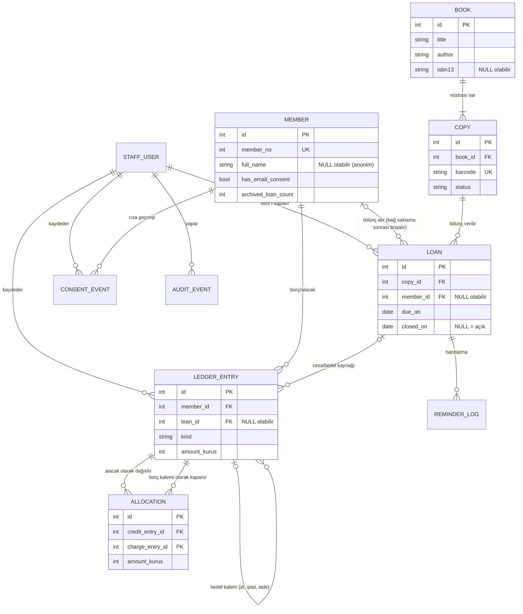

# Veri tasarımı: Kütüphane Ödünç Sistemi

- **Güncelleme:** 2026-10-31
- **İlgili dokümanlar:** [SRS](srs.md), [Mimari](architecture.md), [ADR'ler](decisions/)

Veritabanı SQLite'tır ve WAL modunda çalışır ([ADR-0002](decisions/0002-sqlite-wal.md)). Şema Django 5.2 modelleriyle tanımlanır ([ADR-0013](decisions/0013-django-5-2-lts.md)). Bütün tutarlar tam sayı kuruştur ([ADR-0016](decisions/0016-money-integer-kurus.md)). Tablo adları burada mantıksal adlardır; Django'daki fiziksel ad `<app>_<model>` biçimindedir.

## 1. Kavramsal model (ER)

Bağımsız tablolar: `library_settings` (tek satır), `weekly_closed_day`, `closed_date`, `audit_event`, `job_run`. Ayrıca django-axes ve Django oturum tabloları vardır.

## 2. Mantıksal şema

Ortak kurallar:

- Her tabloda `id INTEGER PK` vardır.
- Zaman damgaları UTC olarak saklanır (`USE_TZ = True`). Tarih alanları (`*_on`) ise Europe/Istanbul yerel takvim günüdür (SRS bölüm 7).
- "Bugün" her zaman `timezone.localdate()` ile alınır.

### 2.1 Personel ve ayarlar

| Tablo | Sütun | Tür | Kısıt | Açıklama |
|---|---|---|---|---|
| staff_user | username | varchar(150) | UNIQUE, NOT NULL | `AbstractUser` alanları (parola Argon2) |
| | role | varchar(10) | NOT NULL, CHECK IN ('ADMIN','CLERK') | Küçük karar 1 |
| | is_active | bool | NOT NULL | FR-21'deki pasifleştirme |
| library_settings | id | int | PK, CHECK id = 1 | Tek satır |
| | loan_period_days | smallint | NOT NULL, CHECK > 0 | Varsayılan değer faz 4 küçük kararı (AC-23 örneği: 14) |
| | max_open_loans | smallint | NOT NULL, CHECK > 0 | Varsayılan değer faz 4 küçük kararı (AC-08 örneği: 3) |
| | daily_fine_kurus | int | NOT NULL, CHECK ≥ 0 | Varsayılan 500 |
| | fine_cap_kurus | int | NOT NULL, CHECK ≥ 0 | Varsayılan 15000 |
| | debt_threshold_kurus | int | NOT NULL, CHECK > 0 | Varsayılan 5000; eşiğe eşit borç engeller |
| | retention_years | smallint | NOT NULL, CHECK > 0 | Varsayılan 2 (küçük karar 4) |
| | updated_at, updated_by_id | timestamp, FK staff_user | | |
| weekly_closed_day | weekday | smallint | UNIQUE, CHECK 0–6 | 0 = pazartesi (Python `weekday()`) |
| closed_date | date | date | UNIQUE | Tek tek kapalı günler |
| | note | varchar(200) | NULL | |

### 2.2 Üyeler

| Tablo | Sütun | Tür | Kısıt | Açıklama |
|---|---|---|---|---|
| member | member_no | int | UNIQUE, NOT NULL | Otomatik ve sıralı (küçük karar 2) |
| | full_name | varchar(200) | NULL | Anonimleştirmede NULL olur |
| | phone | varchar(30) | NULL | Girildiği biçimde |
| | phone_digits | varchar(20) | NULL | Yalnız rakamlar; telefonla arama |
| | email | varchar(254) | NULL | İsteğe bağlı |
| | search_key | varchar(400) | NOT NULL | `normalize_tr(full_name)` ([ADR-0019](decisions/0019-search-normalization.md)) |
| | is_active | bool | NOT NULL | |
| | deactivated_on | date | NULL; CHECK (is_active OR deactivated_on IS NOT NULL) | Saklama süresinin başlangıcı |
| | has_email_consent | bool | NOT NULL | Denormalize ([ADR-0022](decisions/0022-consent-event-history.md)) |
| | archived_loan_count | int | NOT NULL, CHECK ≥ 0 | [ADR-0018](decisions/0018-retention-archived-loan-counter.md) |
| | anonymized_at | timestamp | NULL | Doluysa ad, telefon ve e-posta NULL'dır |
| consent_event | member_id | FK member | NOT NULL, ON DELETE CASCADE | |
| | action | varchar(10) | CHECK IN ('GIVEN','WITHDRAWN') | |
| | effective_on | date | NOT NULL | AC-03'teki tarih |
| | recorded_at, recorded_by_id | timestamp, FK staff_user | NOT NULL | |

### 2.3 Katalog

| Tablo | Sütun | Tür | Kısıt | Açıklama |
|---|---|---|---|---|
| book | title | varchar(300) | NOT NULL | |
| | author | varchar(300) | NOT NULL | Tek metin alanı; birden çok yazar virgülle yazılır |
| | isbn13 | char(13) | NULL, CHECK length = 13 | Tiresiz, doğrulanmış ([ADR-0008](decisions/0008-isbn-correction-suggestion.md)); benzersiz değil |
| | publisher | varchar(200) | NULL | |
| | year | smallint | NULL | |
| | source_ol_id | varchar(30) | NULL | Tohum verideki OL kimliği (AC-29) |
| | search_key | varchar(700) | NOT NULL | `normalize_tr(title + " " + author)` |
| copy | book_id | FK book | NOT NULL, ON DELETE PROTECT | |
| | barcode | char(8) | UNIQUE, NOT NULL | `f"{id:08d}"`; kayıttan hemen sonra aynı işlemde atanır (küçük karar 3) |
| | status | varchar(12) | CHECK IN ('ON_SHELF','ON_LOAN','LOST','DAMAGED','WITHDRAWN') | FR-05; durum makinesi mimari bölüm 5'te |
| | status_changed_at | timestamp | NOT NULL | |

### 2.4 Ödünç

| Tablo | Sütun | Tür | Kısıt | Açıklama |
|---|---|---|---|---|
| loan | copy_id | FK copy | NOT NULL, ON DELETE PROTECT | |
| | member_id | FK member | NULL, ON DELETE PROTECT | Saklama süresinden sonra NULL olur |
| | loaned_on | date | NOT NULL | |
| | due_on | date | NOT NULL, CHECK due_on > loaned_on | Kapalı gün kaydırması uygulanmış (FR-07) |
| | renewed_on | date | NULL | Doluysa uzatma hakkı kullanılmıştır (FR-10) |
| | daily_fine_kurus, fine_cap_kurus | int | NOT NULL | Ödünç anındaki oranın kopyası ([ADR-0023](decisions/0023-fine-rate-snapshot.md)) |
| | closed_on | date | NULL | NULL ise ödünç açıktır |
| | close_reason | varchar(10) | NULL, CHECK IN ('RETURNED','LOST','DAMAGED'); CHECK (closed_on IS NULL) = (close_reason IS NULL) | |
| | created_by_id, closed_by_id | FK staff_user | closed_by NULL olabilir | |
| | member_unlinked_at | timestamp | NULL | |

**Kısıt:** `UNIQUE(copy_id) WHERE closed_on IS NULL`. Bir nüshanın en fazla bir açık ödüncü olabilir.

### 2.5 Borç defteri

| Tablo | Sütun | Tür | Kısıt | Açıklama |
|---|---|---|---|---|
| ledger_entry | member_id | FK member | NOT NULL, ON DELETE PROTECT | Anonimleştirmeden sonra da kalır (FR-25) |
| | loan_id | FK loan | NULL | Ceza ve bedelde dolu; saklama süresinden sonra NULL |
| | kind | varchar(12) | CHECK IN ('FINE','FEE','PAYMENT','WAIVER','CANCELLATION','REFUND') | |
| | amount_kurus | int | NOT NULL, CHECK > 0 | Yönü türden gelir |
| | target_entry_id | FK ledger_entry | NULL; WAIVER, CANCELLATION ve REFUND'da NOT NULL (CHECK) | Hedef borç kalemi |
| | reason | varchar(500) | NULL; WAIVER'da NOT NULL ve boş olamaz (CHECK) | FR-14 |
| | created_at, created_by_id | timestamp, FK staff_user | NOT NULL | Zamanlanmış görev yazmaz |
| allocation | credit_entry_id | FK ledger_entry | NOT NULL | PAYMENT, WAIVER ya da CANCELLATION |
| | charge_entry_id | FK ledger_entry | NOT NULL | FINE ya da FEE |
| | amount_kurus | int | NOT NULL, CHECK > 0 | |
| | | | UNIQUE(credit_entry_id, charge_entry_id) | |

Hareket türlerinin anlamı:

| Tür | Yön | Bakiyeye etkisi | Dağıtım |
|---|---|---|---|
| FINE (ceza) | Borç | + | Dağıtımları kendine çeker |
| FEE (bedel) | Borç | + | Dağıtımları kendine çeker |
| PAYMENT (ödeme) | Alacak | − | FIFO: en eski açık kalemden başlar ([ADR-0017](decisions/0017-payment-fifo-allocation.md)) |
| WAIVER (af) | Alacak | − | Tek hedef kalem ([ADR-0021](decisions/0021-waiver-targeted.md)) |
| CANCELLATION (iptal) | Alacak | − | Tek hedef bedel kalemi (FR-16) |
| REFUND (iade) | Nötr | 0 | Dağıtım yok; hedef bedelin ödenmiş kısmını iade edilmiş sayar ([ADR-0020](decisions/0020-refund-ledger-entry.md)) |

**Değişmezler.** Servis katmanı bunları işlem içinde korur; her biri için bir test bulunur.

- I1: `balance(m) = Σ FINE,FEE − Σ PAYMENT,WAIVER,CANCELLATION ≥ 0`. Borçtan fazla ödeme kabul edilmez (FR-13).
- I2: Her alacak hareketi için `Σ allocation.amount = credit.amount`. Alacak tümüyle dağıtılır.
- I3: Her kalem için `paid_or_settled(c) = Σ allocation.amount (charge = c) ≤ c.amount`.
- I4: `unpaid(c) = c.amount − paid_or_settled(c)`.
- I5: Bir bedel kalemi için iade toplamı, o kaleme yapılmış ödeme dağıtımlarının toplamını aşamaz. REFUND yalnız `CANCELLATION` almış bir bedel için girilebilir.
- I6: Hareketler ve dağıtımlar güncellenmez ve silinmez. Düzeltme yeni bir hareketle yapılır.

### 2.6 Bildirim, denetim ve görevler

| Tablo | Sütun | Tür | Kısıt | Açıklama |
|---|---|---|---|---|
| reminder_log | loan_id | FK loan | NOT NULL | Üye bilgisi tekrarlanmaz (ADR-0018) |
| | kind | varchar(10) | CHECK IN ('DUE_SOON','OVERDUE_1','MANUAL') | |
| | status | varchar(6) | CHECK IN ('SENT','FAILED') | |
| | error | varchar(500) | NULL | |
| | sent_at | timestamp | NOT NULL | Deneme zamanı |
| | triggered_by_id | FK staff_user | NULL | MANUAL'da dolu (FR-19) |
| | | | `UNIQUE(loan_id, kind) WHERE status = 'SENT' AND kind <> 'MANUAL'` | FR-18'deki tekrar engeli (küçük karar 7) |
| audit_event | occurred_at | timestamp | NOT NULL | |
| | actor_id | FK staff_user | NULL | NULL ise zamanlanmış görevdir |
| | action | varchar(30) | NOT NULL | Ör. `PAYMENT`, `WAIVER`, `FEE`, `REFUND`, `COPY_LOST`, `COPY_DAMAGED`, `COPY_FOUND`, `SETTINGS_CHANGED`, `CLOSED_DAY_CHANGED`, `STAFF_CHANGED` |
| | target_type, target_id | varchar(30), int | NOT NULL | Tek hedef |
| | details | JSON (TEXT) | NOT NULL | Tutar, gerekçe, eski ve yeni değerler. Üye ile ödünç aynı anda yazılmaz (küçük karar 10) |
| job_run | job | varchar(20) | CHECK IN ('BACKUP','ANONYMIZE','REMINDERS','EXPORT') | |
| | run_on | date | NOT NULL | Görevin ait olduğu yerel gün |
| | started_at, finished_at | timestamp | finished NULL olabilir | |
| | status | varchar(8) | CHECK IN ('RUNNING','SUCCESS','FAILED') | |
| | detail | TEXT | NULL | Sayımlar ve hata metni |

## 3. Normalizasyon

Bütün tablolar en az 3NF'tir. Anahtar dışındaki her öznitelik yalnız anahtara bağlıdır ve geçişli bağımlılık yoktur. Aşağıdaki tablo, normal formun nasıl sağlandığını ve bilinçli denormalizasyonları gösterir.

| Tablo | Fonksiyonel bağımlılıklar | Normal form | Gerekçe ve bilinçli denormalizasyon |
|---|---|---|---|
| member | id → tüm alanlar; member_no → id | BCNF (her belirleyen aday anahtar) | `search_key`, `full_name`'den türer ve NFR-10 aramasına hizmet eder. `phone_digits`, `phone`'dan türer ve telefonla aramaya hizmet eder. `has_email_consent`, son `consent_event`'ten türer ve hatırlatma sorgusuna hizmet eder. Üçü de tek bir servis fonksiyonunda, kaynak alanla aynı işlemde yazılır. `archived_loan_count` türetilmiş değildir, çünkü kaynağı silinmiştir (ADR-0018). |
| consent_event | id → tüm alanlar | BCNF | |
| book | id → tüm alanlar | BCNF | `search_key` türetilmiştir; model `save()` içinde tek noktada yazılır. `author` atomik bir metindir. Ayrı bir yazar varlığı SRS'te istenmediği için 1NF ihlali sayılmaz. |
| copy | id → tüm alanlar; barcode → id | BCNF | `status = ON_LOAN` ile açık ödüncün varlığı birbirinden türetilebilir. Durum alanı, LOST, DAMAGED ve WITHDRAWN gibi ödünçle ilgisi olmayan durumları da taşıdığı için tutulur. Tutarlılığı iki şey sağlar: açık ödünç oluşturma ve kapatma, durum değişikliğiyle aynı işlemdedir; kısmi benzersiz indeks de bir nüshaya ikinci açık ödüncü engeller. |
| loan | id → tüm alanlar | BCNF | `daily_fine_kurus` ve `fine_cap_kurus` ayarlardan kopyalanır, ama denormalizasyon değildir: ödünç anındaki tarihsel bir olgudur (ADR-0023). |
| ledger_entry, allocation | id → tüm alanlar; (credit, charge) → amount | BCNF | Bakiye saklanmaz, her seferinde hesaplanır (bölüm 6, S3). |
| reminder_log, audit_event, job_run | id → tüm alanlar | BCNF | `audit_event.details` JSON'dur. İçeriği yalnız gösterim ve denetim için okunur, sorgu koşulunda kullanılmaz. |
| library_settings | id → tüm alanlar | BCNF | Tek satır. |

## 4. İndeksler

| İndeks | Tablo (sütunlar) | Hizmet ettiği sorgu | Maliyeti (yazma, alan) |
|---|---|---|---|
| UNIQUE | member(member_no) | Kart okutma (FR-11) | 5 bin satırda ihmal edilir |
| | member(phone_digits) | Telefonla arama (FR-01) | İhmal edilir |
| UNIQUE | copy(barcode) | Nüsha okutma, barkodla arama (FR-04, FR-09) | 20 bin satır, ~0,5 MB |
| | copy(book_id) | Kitabın nüshaları | İhmal edilir |
| | book(isbn13) | ISBN ile arama | İhmal edilir |
| UNIQUE, kısmi | loan(copy_id) WHERE closed_on IS NULL | Nüshanın açık ödüncü, çift ödünç engeli | Yalnız açık ödünçler |
| | loan(member_id, closed_on) | Açık ödünç sayısı ve gecikmiş ödünç (FR-08) | 100 bin satır, ~2 MB |
| kısmi | loan(due_on) WHERE closed_on IS NULL | Geciken listesi (FR-20), hatırlatma adayları (FR-18) | Yalnız açık ödünçler |
| | loan(closed_on) | Saklama görevi (FR-25) | ~2 MB |
| | ledger_entry(member_id) | Bakiye ve döküm (FR-08, FR-17) | Yazma başına bir indeks güncellemesi |
| | ledger_entry(target_entry_id) | Kalemin af, iptal ve iadeleri | İhmal edilir |
| | ledger_entry(loan_id) | Ödüncün ceza ve bedeli (FR-16), bağın koparılması | İhmal edilir |
| | allocation(charge_entry_id) | Kalemin ödenmemiş kısmı (I4) | İhmal edilir |
| UNIQUE, kısmi | reminder_log(loan_id, kind) WHERE status = 'SENT' AND kind <> 'MANUAL' | Tekrar engeli | İhmal edilir |
| | audit_event(occurred_at) | Denetim kaydı listesi | Yılda ~10 bin satır |
| | job_run(job, run_on) | Son başarılı çalışma (NFR-05) | İhmal edilir |

Arama sütunlarında (`search_key`) indeks yoktur. `LIKE '%…%'` indeks kullanamaz ve tam tarama tasarım ölçeğinde yeterlidir (ADR-0019).

## 5. İşlemler ve eşzamanlılık

- **Bağlantı ayarları:** `journal_mode=WAL`, `synchronous=NORMAL`, `foreign_keys=ON`, `busy_timeout=5000` ve Django `transaction_mode = "IMMEDIATE"` ([ADR-0002](decisions/0002-sqlite-wal.md)).
- **İzolasyon:** SQLite yazma işlemlerinde serileştirilebilir (serializable) davranır. IMMEDIATE işlem, yazma kilidini başta alır. Böylece "oku, kontrol et, yaz" adımları arasına başka bir yazıcı giremez. Kayıp güncelleme, tekrarlanamayan okuma ve hayalet satır anomalileri yazma işlemlerinde oluşmaz. Okuma isteklerinin her biri WAL anlık görüntüsünde tutarlı bir görünüm alır.
- **İşlem sınırları:** Her servis fonksiyonu tek bir `transaction.atomic()` bloğudur. Denetim kaydı aynı işlemde yazılır.

| İşlem | İşlem içinde yapılanlar | Önlenen hata |
|---|---|---|
| Ödünç verme (FR-07, FR-08) | Üye ve nüsha okunur, engeller değerlendirilir, ödünç eklenir, nüsha `ON_LOAN` yapılır | Aynı nüshanın iki masada aynı anda verilmesi; buna karşı ikinci güvence kısmi benzersiz indekstir |
| İade (FR-09) | Açık ödünç kapatılır, nüsha `ON_SHELF` yapılır, gerekirse FINE eklenir | Çift iade; ikinci istek açık ödünç bulamaz ve hata alır |
| Uzatma (FR-10) | `renewed_on IS NULL` koşulu, gecikme ve bakiye kontrol edilir, `due_on` güncellenir | Çift uzatma |
| Ödeme (FR-13) | Bakiye hesaplanır, tutar ≤ bakiye kontrol edilir, PAYMENT ve FIFO dağıtımları ile denetim kaydı yazılır | Borçtan fazla ödeme (I1), yarım dağıtım (I2) |
| Af (FR-14) | Hedef kalemin ödenmemiş kısmı kontrol edilir, WAIVER, dağıtım ve denetim kaydı yazılır | Ödenmemiş kısmı aşan af |
| Kayıp/hasar (FR-15) | Ödünç kapatılır, nüsha LOST ya da DAMAGED yapılır, FINE (birikmiş ceza) ve FEE ile denetim kaydı yazılır | Yarım kalan işaretleme |
| Bulundu (FR-16) | Nüsha `ON_SHELF` yapılır, bedelin ödenmemiş kısmı için CANCELLATION ve denetim kaydı yazılır | Ödenmiş kısmın iptali |
| Anonimleştirme (FR-25) | Kayıt başına bir işlem: üye alanları NULL yapılır, rıza olayları silinir; ödüncün bağı kopar, sayaç artar, defterin ödünç bağı boşalır | Sayaç ile bağ arasında tutarsızlık |
| Hatırlatma (FR-18) | Önce e-posta gönderilir, ardından reminder_log kendi işleminde yazılır. Benzersiz kısıt ihlali, gönderilmiş sayılır | SMTP çağrısı sırasında veritabanı kilidi tutulmaz. Gönderimden sonra çökme olursa nadiren tek bir tekrar olabilir; kabul edilen risk, mimari bölüm 10 |

## 6. Kritik sorgular

n_l = 100.000 ödünç, n_c = 20.000 nüsha, n_m = 5.000 üye, e_m = bir üyenin defter satırı sayısı (tipik olarak 20'nin altında).

| # | Sorgu | Eşdeğer SQL | Beklenen plan | Maliyet |
|---|---|---|---|---|
| S1 | Nüsha okutma | `SELECT … FROM copy JOIN book … WHERE barcode = ?` | copy(barcode) UNIQUE araması | O(log n_c) |
| S2 | Açık ödünç sayısı ve gecikme | `SELECT COUNT(*), SUM(due_on < :today) FROM loan WHERE member_id = ? AND closed_on IS NULL` | loan(member_id, closed_on) aralık taraması | O(log n_l + k), k ≤ limit |
| S3 | Bakiye | `SELECT SUM(CASE WHEN kind IN ('FINE','FEE') THEN amount_kurus WHEN kind IN ('PAYMENT','WAIVER','CANCELLATION') THEN -amount_kurus ELSE 0 END) FROM ledger_entry WHERE member_id = ?` | ledger_entry(member_id) | O(log N + e_m) |
| S4 | Kalemlerin ödenmemiş kısmı (FIFO için) | `SELECT c.id, c.amount_kurus - COALESCE(SUM(a.amount_kurus),0) FROM ledger_entry c LEFT JOIN allocation a ON a.charge_entry_id = c.id WHERE c.member_id = ? AND c.kind IN ('FINE','FEE') GROUP BY c.id HAVING … > 0 ORDER BY c.created_at, c.id` | member_id ve charge_entry_id indeksleri | O(e_m log e_m) |
| S5 | Geciken listesi (FR-20) | `SELECT … FROM loan JOIN copy JOIN book LEFT JOIN member WHERE closed_on IS NULL AND due_on < :today ORDER BY due_on` | Kısmi due_on indeksi; birleştirmeler PK ile | O(o log n), o = gecikmiş sayısı |
| S6 | Hatırlatma adayları (FR-18) | Açık ödünçler, `due_on BETWEEN :today AND :today+2` (DUE_SOON) ya da `due_on BETWEEN :today-7 AND :today-1` (OVERDUE_1). Üye aktif, rızalı ve e-postalı olmalı; `NOT EXISTS reminder_log (SENT)` | Kısmi due_on aralık taraması | O(log n_l + a) |
| S7 | Arama (FR-01, FR-04) | `… WHERE search_key LIKE '%' \|\| :q \|\| '%' LIMIT 50` | Tam tarama | O(n·L); 20 bin kitapta birkaç ms |
| S8 | Saklama görevi (FR-25) | `loan WHERE closed_on < :cutoff AND member_id IS NOT NULL`; `member WHERE deactivated_on < :cutoff AND anonymized_at IS NULL` | loan(closed_on); member tam tarama (5 bin satır) | O(log n_l + r) |

Ödünç verme isteği S1, S2, S3 ve iki yazma işleminden oluşur. Tasarım ölçeğinde veritabanı süresi 10 ms'nin altında beklenir. NFR-01'deki p95 < 500 ms hedefi faz 6'da tasarım ölçeğinde tohum veriyle ölçülecek. Gerçek planlar o zaman `EXPLAIN QUERY PLAN` ile doğrulanacak.

## 7. Hacim, büyüme ve saklama

| Tablo | Tasarım ölçeği | Büyüme | Saklama |
|---|---|---|---|
| member | 5.000 | Yavaş | Pasifleştirme + saklama süresi sonunda anonimleştirilir; satır kalır |
| consent_event | ~5.000 | Yavaş | Üye anonimleştirilince silinir (küçük karar 8) |
| book / copy | 15.000 / 20.000 | Yavaş | Süresiz; nüsha silinmez, `WITHDRAWN` olur |
| loan | 100.000 | ~10–20 bin/yıl | Süresiz; iade + saklama süresi sonunda üye bağı kopar |
| ledger_entry / allocation | ~30.000 / ~30.000 | Gecikmelerle orantılı | Süresiz; ödünç bağı saklama sonunda kopar |
| reminder_log | ~200.000 | Ödünç başına ≤ 2 otomatik | Süresiz; üye bilgisi içermez |
| audit_event | ~10.000/yıl | Yavaş | Süresiz |

- Veritabanı dosyasının tasarım ölçeğinde 100 MB'ın altında kalması beklenir.
- Günlük yedek 02:00'de, SQLite backup API ile `library-YYYYMMDD.sqlite3` adıyla harici diske alınır. Son 30 gün tutulur (FR-28, küçük karar 13 ve 14).
- Haftalık şifreli dışa aktarma pazartesi 03:00'te yapılır ([ADR-0006](decisions/0006-offsite-backup-usb-rotation.md), [ADR-0011](decisions/0011-backup-encryption-cryptography.md)).

## 8. Göç stratejisi

- Şema değişiklikleri Django migration'larıyla yapılır ve migration dosyaları depoda tutulur.
- Üretimde `migrate` komutundan önce `backup_db` elle de çalıştırılır. Kurulum belgesinde bu bir adımdır.
- Geri alma, migration'dan önceki yedeği geri yüklemektir. SQLite'ta şema geri almak için bu tek güvenilir yoldur. Veri migration'ları mümkün olduğunda geri alınabilir (`RunPython` ve tersi) yazılır.
- Migration zinciri test paketinde boş bir veritabanına tam zincirin uygulanmasıyla doğrulanır.

## 9. Tohum veri (FR-29)

- **Kaynaklar ve lisanslar:** Üyeler sentetiktir. Kitaplar Open Library'den gelir (CC0, orta güven; [rapor](research/2026-10-31-demo-kitap-veri-seti.md)) ya da sentetiktir. Yalnız bibliyografik alanlar alınır, her kayıtta `source_ol_id` tutulur ve atıf notu konur.
- **Açık nokta (R-06, faz 4):** Demo setinin boyutu ve seçim/temizlik ölçütü henüz karara bağlanmadı. Kayıtların yaklaşık üçte birinde Türkçe karakter kaybı ve bozuk yayınevi alanı var. Önceki notta geçen 500 kayıtlık alt sınır da teyit edilmedi.
- NFR-01 ölçümü için tasarım ölçeğine (NFR-02) ulaşan ayrı bir sentetik yük seti gerekir. Üretim yöntemi faz 4'te belirlenecek.
